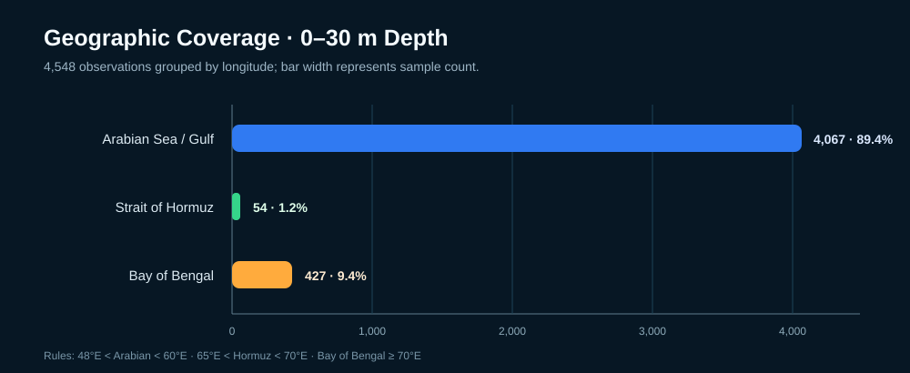
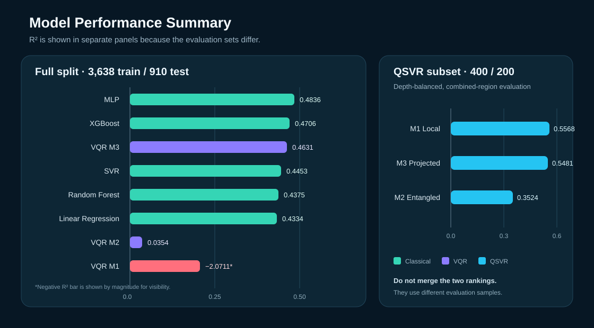

# Satellite-Derived Shallow-Water Bathymetry Using Classical and Quantum Machine Learning

This project estimates shallow-water depth from satellite-derived spectral features and compares classical regression, Variational Quantum Regression (VQR), and Quantum Support Vector Regression (QSVR).

## 1. Title and Team

**Project title:** Satellite-Derived Shallow-Water Bathymetry Using Classical and Quantum Machine Learning

| Role | Name | Register number |
|---|---|---|
| Team member 1 | `[Add name]` | `[Add register number]` |
| Team member 2 | `[Add name]` | `[Add register number]` |
| Team member 3 | `[Add name]` | `[Add register number]` |
| Team member 4 | `[Add name]` | `[Add register number]` |
| Faculty guide | `[Add faculty guide]` | — |

> Replace the bracketed fields before submission. These details were not present in the repository.

## 2. Problem Statement

Conventional bathymetric surveys require specialized equipment, field time, and significant cost. This project investigates whether water depth in the **0–30 m shallow-water range** can be estimated from satellite-derived blue/green spectral information.

The objectives are to:

1. Prepare spectral and ratio features for shallow-water depth prediction.
2. Compare classical regression models with variational and kernel-based quantum models.
3. Evaluate predictions using MAE, RMSE, and R².
4. Study observations from the Arabian Sea/Gulf, Strait of Hormuz, and Bay of Bengal.
5. Measure the accuracy–runtime trade-off of three distinct QSVR methods.

## 3. Dataset

### Source

- **Dataset name:** Satellite-Derived Bathymetry (SDB) dataset
- **Source link:** `[Add the verified public or institutional dataset URL]`
- **Primary file:** `Dataset/final_sdb_dataset_clean.csv`
- **Additional file:** `Dataset/final_sdb_dataset_clean(2).csv`

> The notebooks do not currently document the original satellite mission, bathymetric reference survey, collection date, spatial resolution, licence, or source URL. These details must be verified before publication or final academic submission.

### Original and additional data

| Dataset | Rows | Columns | Use in this project |
|---|---:|---:|---|
| `final_sdb_dataset_clean.csv` | 11,676 | 9 | Primary dataset used by the model pipeline |
| Shallow-water subset | 4,548 | 9 | Records with depth from 0 to 30 m used for modeling |
| `final_sdb_dataset_clean(2).csv` | 8,000 | 5 | Additional dataset present in the repository but not used by the current notebooks |

The primary data contains latitude, longitude, blue band, green band, depth, Stumpf ratio, log-blue, log-green, and blue/green ratio. Models use these six spectral predictors:

- `blue_band`
- `green_band`
- `log_blue`
- `log_green`
- `bg_ratio`
- `stumpf_ratio`

Latitude and longitude define the regional groups but are not used as predictive inputs.

### Geographic study area

| Region | Longitude rule used in code | Shallow-water samples |
|---|---|---:|
| Arabian Sea / Gulf | `48 < longitude < 60` | 4,067 |
| Strait of Hormuz | `65 < longitude < 70` | 54 |
| Bay of Bengal | `longitude >= 70` | 427 |

The regional plot displays reference boundaries at 60° E and 70° E, while the implemented Strait of Hormuz rule starts above 65° E. The current dataset contains no records in the excluded 60–65° E interval, so the three groups still account for all 4,548 shallow observations.



## 4. Methods

The PBL grouping below follows the current repository organization. Update the PBL labels if the official course allotment differs.

### PBL 1 — Classical machine learning (Units 1–5)

| Unit | Algorithm | Main configuration |
|---:|---|---|
| 1 | Linear Regression | Default ordinary least-squares regression |
| 2 | Random Forest | 100 trees, maximum depth 15, seed 42 |
| 3 | Multilayer Perceptron | Hidden layers (64, 32), ReLU, Adam, early stopping |
| 4 | Support Vector Regression | RBF kernel, C=10, epsilon=0.1 |
| 5 | XGBoost | 100 estimators, learning rate 0.1, maximum depth 6 |

### PBL 2 — Variational Quantum Regression

| Method | Approach |
|---|---|
| VQR M1 | Six-qubit Qiskit circuit, RY feature encoding, two-layer RY/RZ ansatz, linear CNOT entanglement, COBYLA |
| VQR M2 | Six-qubit PennyLane circuit, RX encoding, six-layer circular RY/RZ ansatz, Adam |
| VQR M3 | Standardized inputs and target, AngleEmbedding, four StronglyEntanglingLayers, affine readout, Adam |

### PBL 3 — Quantum Support Vector Regression

The QSVR methods use a deterministic, depth-balanced subset of **400 training and 200 test observations**, sampled across the 0–10 m, 10–20 m, and 20–30 m intervals.

| Method | Approach |
|---|---|
| QSVR M1 | Local Z-feature-map fidelity kernel, two repetitions, no entanglement |
| QSVR M2 | Entangled ZZ-feature-map fidelity kernel, two repetitions, linear entanglement |
| QSVR M3 | PennyLane projected quantum features followed by an RBF kernel using a median-distance bandwidth |

The QSVR subset combines observations from all three geographic groups. It is balanced by **depth**, not by region; therefore, its scores are combined-region results rather than separate Arabian Sea, Hormuz, or Bay of Bengal scores.

## 5. Results

### Full 3,638/910 train/test split

| Rank by R² | Model | Family | MAE (m) | RMSE (m) | R² |
|---:|---|---|---:|---:|---:|
| 1 | MLP | Classical | 4.9935 | **6.3775** | **0.4836** |
| 2 | XGBoost | Classical | 4.9535 | 6.4577 | 0.4706 |
| 3 | VQR M3 | Quantum | 5.1573 | 6.5028 | 0.4631 |
| 4 | SVR | Classical | **4.7868** | 6.6097 | 0.4453 |
| 5 | Random Forest | Classical | 5.0608 | 6.6561 | 0.4375 |
| 6 | Linear Regression | Classical | 5.3373 | 6.6804 | 0.4334 |
| 7 | VQR M2 | Quantum | 7.6518 | 8.7164 | 0.0354 |
| 8 | VQR M1 | Quantum | 12.8481 | 15.5530 | -2.0711 |

On the full split, MLP provides the highest R² and lowest RMSE, SVR provides the lowest MAE, and VQR M3 is the strongest full-split quantum result.

### QSVR depth-balanced 400/200 subset

| Rank by R² | Method | MAE (m) | RMSE (m) | R² | Kernel build (s) | SVR fit (s) | Prediction (s) |
|---:|---|---:|---:|---:|---:|---:|---:|
| 1 | QSVR M1 — Local Fidelity | **4.4440** | **5.9560** | **0.5568** | 6,092.53 | 0.03 | 0.0020 |
| 2 | QSVR M3 — Projected Kernel | 4.4885 | 6.0144 | 0.5481 | **10.22** | 0.04 | 0.0045 |
| 3 | QSVR M2 — Entangled Fidelity | 5.2569 | 7.1996 | 0.3524 | 10,515.40 | 0.09 | 0.0034 |

QSVR M1 is the most accurate QSVR method. QSVR M3 is only 0.0087 lower in R² but builds its kernel roughly 596 times faster than M1, giving it the best accuracy–runtime balance. The QSVR values must not be ranked directly against the full-split table because the evaluation observations and sample counts differ.



### Important regional findings

- Arabian Sea/Gulf: MLP has the highest reported regional R², 0.5168.
- Strait of Hormuz: Random Forest reaches R² 0.8251, but the region has only 54 total observations and roughly 11 test samples, so this estimate is highly uncertain.
- Bay of Bengal: SVR is strongest, with MAE 4.9596 m, RMSE 6.5862 m, and R² 0.4106.

## 6. How to Run

### Requirements

- Python 3.10 or 3.11
- JupyterLab or Jupyter Notebook
- A machine with sufficient memory for quantum-kernel matrices

### Installation

From PowerShell:

```powershell
cd D:\PassionProjects\Bathymetry
py -m venv .venv
.\.venv\Scripts\Activate.ps1
python -m pip install --upgrade pip
pip install numpy pandas matplotlib seaborn scikit-learn xgboost jupyterlab pennylane qiskit qiskit-machine-learning qiskit-algorithms
jupyter lab
```

For Linux or macOS, activate the environment with `source .venv/bin/activate` instead.

### Recommended notebook order

1. `Models/DataParser.ipynb` — inspect and filter the dataset.
2. Run the classical notebooks independently:
   - `Models/LinearRegression.ipynb`
   - `Models/RandomForest.ipynb`
   - `Models/MLP.ipynb`
   - `Models/SVR.ipynb`
   - `Models/XGBoost.ipynb`
3. `QuantumMachineLearning/Encoding.ipynb` — create the shared angle-encoded train/test CSV files.
4. Run the VQR notebooks independently:
   - `QuantumMachineLearning/VQR_Method1.ipynb`
   - `QuantumMachineLearning/VQR_Method2.ipynb`
   - `QuantumMachineLearning/VQR_Method3.ipynb`
5. Run each QSVR method separately:
   - `QuantumMachineLearning/QSVR_M1.ipynb`
   - `QuantumMachineLearning/QSVR_M2.ipynb`
   - `QuantumMachineLearning/QSVR_M3.ipynb`
6. Use `Classical_Quantum_Model_Comparisons.ipynb` for comparison after updating it with VQR M3 and QSVR outputs.

### QSVR runtime warning

With the current 400/200 subset, the recorded kernel-build times are approximately 102 minutes for M1, 175 minutes for M2, and 10 seconds for M3. Run M1, M2, and M3 separately and save the executed notebook after each run. Setting `MAX_TRAIN_SAMPLES` or `MAX_TEST_SAMPLES` to `None` requests the full split and can increase fidelity-kernel cost substantially.

## Repository Structure

```text
Bathymetry/
├── Dataset/                         # Primary and additional CSV files
├── Models/                          # Data preparation and classical models
├── QuantumMachineLearning/          # Encoding, VQR, and separate QSVR methods
├── bathymetry-landing-page-separated-qsvr/
├── Classical_Quantum_Model_Comparisons.ipynb
├── Bathymetry_Project_Report.md
└── README.md
```

## Reproducibility Notes

- The standard global split uses `test_size=0.20` and `random_state=42`.
- The current evaluation is random rather than spatial, so nearby geographic observations may occur in both training and test sets.
- The QSVR result captures report completed runs, but their output cells should be saved into the standalone notebooks.
- Confirm the dataset source, depth units, and licence before publication.
- For a fair cross-family comparison, evaluate every model on exactly the same observations or run QSVR on the full split.

